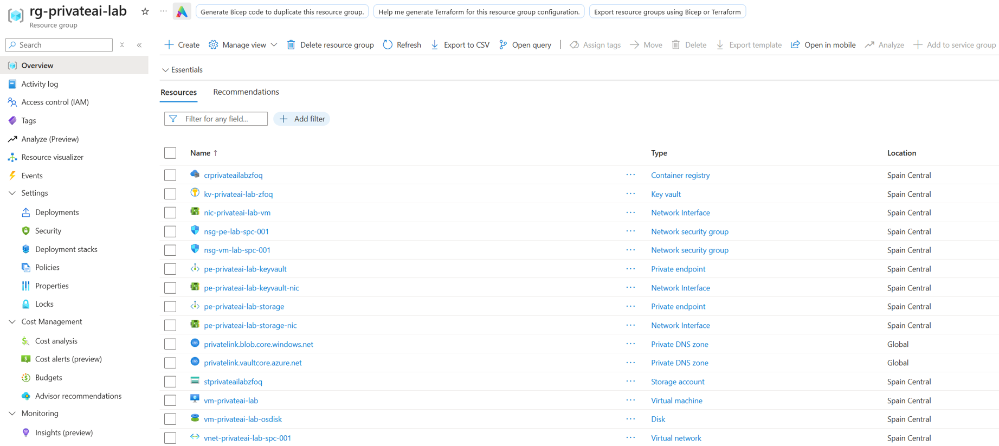

# Azure Private AI: Terraform

Infrastructure for a private VM on Azure: network, private endpoints, Key Vault, Storage,
Container Registry and the identities for GitHub Actions. The VM has no public IP.

The structure is a root module that composes child modules, with data-driven values:
`environments/lab` (root) calls one child module per Azure resource in `modules/`, and each call
is a `for_each` over a map that comes from `values/lab/*.auto.tfvars`. Adding a resource means
adding an entry to a values file, not editing code. Each child module takes its inputs as
variables and knows nothing about the environment.



## Deploy

You need Terraform 1.9+ and `az login`.

1. Remote state, once:

   ```bash
   cd infra/bootstrap
   terraform init
   terraform plan -out=tfplan
   terraform apply tfplan
   ```

   Copy the `storage_account_name` output into `infra/environments/lab/backend.tf`.

2. Optional: put your public IP in `infra/values/lab/operator.auto.tfvars`, from https://ifconfig.me.
   It lets you upload documents and set secrets from the portal. Leave it empty to keep everything private.

3. The lab. From `infra/environments/lab`, set the variables once per terminal.

   Git Bash or WSL:

   ```bash
   export TF_CLI_ARGS_plan="$(printf -- '-var-file=%s ' ../../values/lab/*.tfvars)"
   ```

   PowerShell:

   ```powershell
   $env:TF_CLI_ARGS_plan = (Get-ChildItem ../../values/lab/*.tfvars | ForEach-Object { "-var-file=../../values/lab/$($_.Name)" }) -join ' '
   ```

   Then, in either shell:

   ```bash
   terraform init
   terraform plan -out=tfplan
   terraform apply tfplan
   ```

   Do not set `TF_CLI_ARGS_apply`: a saved plan already contains its values.

The outputs at the end contain the values for GitHub and the names of the resources.

## Destroy

From `infra/environments/lab`:

Git Bash or WSL:

```bash
export TF_CLI_ARGS_destroy="$TF_CLI_ARGS_plan"
terraform destroy
```

PowerShell:

```powershell
$env:TF_CLI_ARGS_destroy = $env:TF_CLI_ARGS_plan
terraform destroy
```

Run the `TF_CLI_ARGS_plan` line from the Deploy section first in the same terminal.

The bootstrap state storage is kept on purpose. It has `prevent_destroy`.

## Layout

```
infra/bootstrap/          remote state storage, run once
infra/environments/lab/   the whole workload
infra/modules/            one module per Azure resource
infra/scripts/            files Terraform reads, such as the VM's cloud-init
infra/values/lab/         values, one file per variable or group
```
