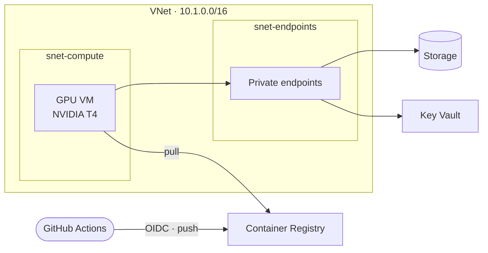

# Azure Private AI Lab — Terraform

[](https://github.com/adrian-olias/terraform-azure-private-ai/actions/workflows/terraform-ci.yml)

A private GPU VM on Azure for AI workloads. No public IP, no inbound ports, no stored secrets.



| | |
|---|---|
| **Network** | One VNet, two subnets, one NSG per subnet. Every NSG denies inbound by default |
| **Compute** | The VM has a private IP only. It is managed with `az vm run-command`, so it needs no SSH |
| **Data** | Storage and Key Vault are reachable only through private endpoints, with Entra ID and RBAC only |
| **Identity** | Managed identity for the VM, one read role per service. OIDC for GitHub Actions |

## Structure

```
infra/
├── bootstrap/                       remote state storage (run once, local state)
├── environments/
│   └── lab/                         root module: the whole workload, one state
├── modules/                         one module per Azure resource
│   ├── resource_group/
│   ├── virtual_network/
│   ├── subnet/
│   ├── network_security_group/      NSG, deny-all inbound unless allowed
│   ├── subnet_network_security_group_association/
│   ├── network_interface/           NIC with a private IP only
│   ├── linux_vm/                    Ubuntu VM with managed identity
│   ├── private_dns_zone/
│   ├── private_dns_zone_vnet_link/
│   ├── private_endpoint/            endpoint registered in a private DNS zone
│   ├── storage_account/             private, Entra ID only
│   ├── storage_container/
│   ├── key_vault/                   private, RBAC only
│   ├── container_registry/          admin user always off
│   ├── role_assignment/
│   └── github_oidc/                 GitHub Actions identity, no secrets
└── values/
    └── lab/                         one .auto.tfvars per .tf file, plus backend.hcl
scripts/vm/                          GPU drivers and Docker setup
```

### How the root module is written

- Each file in `environments/lab/` calls **one module** and is named after it. The module comes first, then the file's own variables.
- Every module is called with `for_each` over a map, so adding a resource means adding an entry to a value file, not editing code.
- The root has **no hardcoded values**. Names, CIDRs, SKUs, ports and tags live in `infra/values/lab/<same name>.auto.tfvars`.
- Map keys are the Azure names (`vm-privateai-lab`, `snet-compute`), so Terraform and the portal use the same names. Resources point to each other by those keys (`resource_group_key = "rg-privateai-lab"`). Storage, Key Vault and ACR use the key as a prefix, because Azure needs a random suffix to make the name globally unique.
- Only what cannot be a variable stays in code: provider versions and provider settings. The backend values are in `values/lab/backend.hcl`.

Names follow `<type>-<project>-<environment>`, e.g. `rg-privateai-lab` or `vm-privateai-lab`. Everything that changes between environments is in `infra/values/lab/`.

## Decisions

| Decision | Why | What I would change at scale |
|---|---|---|
| One state for the lab | One workload. One `apply`, no cross-state lookups | Separate states per environment, or hub-spoke with peering for shared network services |
| No Azure Firewall or NAT Gateway | Cost of a lab | Firewall in a hub and a NAT Gateway for egress. The VM's default outbound access would be disabled |
| Private endpoints, no public access | Data never crosses the public internet | Same |
| OIDC instead of client secrets | Nothing to store, rotate or leak | Same |
| RBAC per service, managed identity for the VM | Least privilege: each identity gets one role on one resource | Same, with custom roles where the built-in ones are too broad |
| Modules per Azure resource | Each piece can be read and reused alone | Same |
| Security settings fixed inside modules | No public access, no keys, no admin user and deny-all NSGs cannot be turned off by a caller. Everything else is a variable with a safe default | Same |

## Deploy

```bash
az login
export ARM_SUBSCRIPTION_ID="$(az account show --query id -o tsv)"

# 1. Remote state (once)
terraform -chdir=infra/bootstrap init
terraform -chdir=infra/bootstrap apply
STATE_SA="$(terraform -chdir=infra/bootstrap output -raw storage_account_name)"

# 2. Lab. The values are not loaded automatically, so every file in values/lab is passed explicitly
VARS=(); for f in "$PWD"/infra/values/lab/*.tfvars; do VARS+=(-var-file="$f"); done
terraform -chdir=infra/environments/lab init \
  -backend-config="$PWD/infra/values/lab/backend.hcl" \
  -backend-config="storage_account_name=$STATE_SA"
terraform -chdir=infra/environments/lab apply "${VARS[@]}"

# 3. GPU drivers + Docker on the VM (no SSH needed). Outputs are maps by key, read here with jq
az vm run-command invoke \
  -g "$(terraform -chdir=infra/environments/lab output -json resource_group_names | jq -r '."rg-privateai-lab"')" \
  -n "$(terraform -chdir=infra/environments/lab output -json vm_names | jq -r '."vm-privateai-lab"')" \
  --command-id RunShellScript --scripts @scripts/vm/install-gpu-docker.sh
```

`terraform -chdir=infra/environments/lab output github_oidc` prints the values the app repo needs for `azure/login`, by key.

To destroy the lab: `terraform -chdir=infra/environments/lab destroy "${VARS[@]}"`. The bootstrap state storage has `prevent_destroy` on purpose.

## Production notes

To keep the lab cheap and simple, a few things are left out on purpose:

- **Azure Firewall** and **NAT Gateway** for egress, instead of Azure default outbound access.
- **Premium ACR**, so the registry can have its own private endpoint.
- **Key Vault purge protection** (disabled here so the lab can be recreated).

## Related

[`azure-private-ai-cicd`](https://github.com/adrian-olias/azure-private-ai-cicd): the app and its pipeline.

## License

[MIT](LICENSE)
